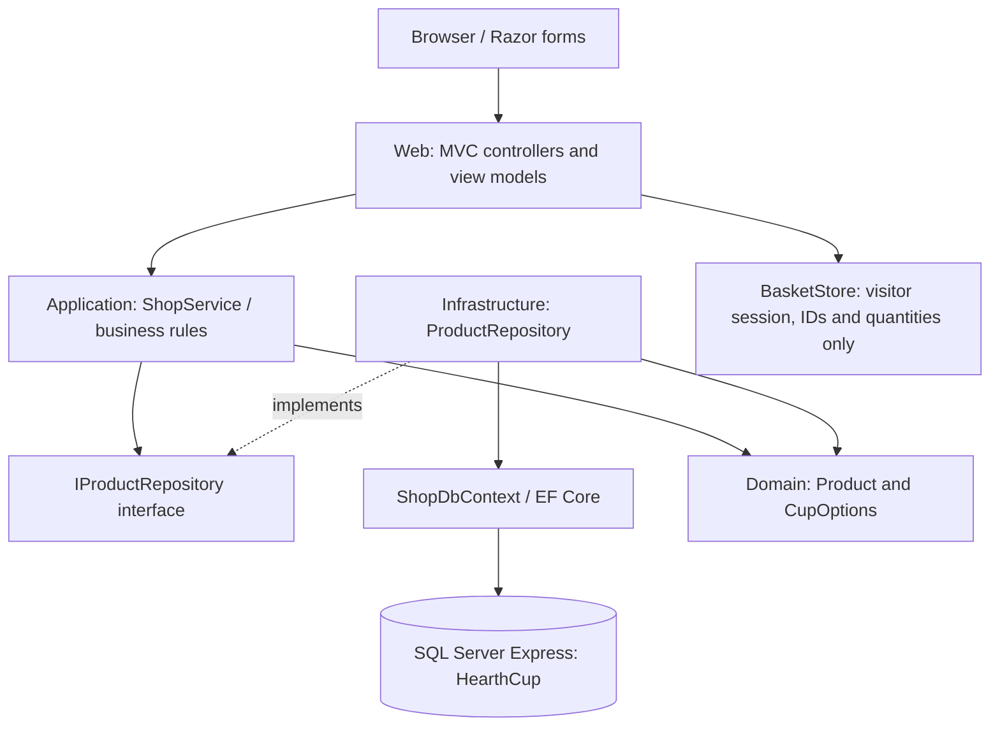

# Assessment implementation map

## Functional requirements

| Brief requirement | Implementation | Demonstration |
|---|---|---|
| Create/read/update/delete product records | `ManageController`, `ProductInput`, `ShopService`, `ProductRepository` | Sign in; create a cup, view it in the shop, edit its price and delete it |
| Product browsing, filtering, pagination | `HomeController.Index`, `ProductRepository.SearchAsync`, Home Index and `_Pagination` | Combine category/material/stock, search, change sorting and page |
| Add/view/remove basket items | `CartController`, `ShopService`, `BasketStore` | Add cups, view total, remove a cup, show empty state |
| Consistent UI | Shared layout, site.css, local product photos and original hero illustration | Desktop and mobile, focus states and error feedback |
| MVC and n-tier | Domain/Application/Infrastructure/Web projects | Explain references, dependency injection and a request from browser to database |

## Architecture

The Web composition root registers interfaces and implementations. Business services have no reference to MVC or EF Core. Persistence is isolated behind an interface; test doubles replace it without a running database. MVC separates the HTTP controller, strongly typed view models and Razor views. n-tier adds responsibility boundaries between presentation, business rules and persistence; these are logical layers in a single process, not separately deployed servers.

## Five quality attributes

| Attribute | Actual tactic / code | Evidence and limitation |
|---|---|---|
| Availability | SQL transient-failure retry in `Program.cs`; centralized exception handling, structured logging and `/health` readiness | DB health returns 503 when unavailable; generic user error page. This is limited recovery and diagnostics, NOT replication, failover or guaranteed uptime |
| Modifiability | Separation of concerns, `IProductRepository`, constructor injection, shared layout and reusable partials | Replace persistence behind the interface or add a filter without moving query logic into Razor; no external feed coupling |
| Testability | Repository port, deterministic business service and dedicated Checks project | Stock, malformed input, money and current-product basket rules run without SQL or a web server; browser checks cover integrated MVC/SQL flows |
| Usability | Search/filter/pagination, labelled forms, stock states, delete confirmation, success/error messages, responsive CSS | Keyboard focus, skip link and reduced-motion support. Photos are sourced from Amazon UK and prices are dated snapshots; no user-study results are claimed |
| Security | Manager role authorization, cookie authentication, hashed random development password, rate-limited login, global antiforgery validation, data annotations and application validation, Razor encoding and CSP | Unauthorized admin blocked; POST needs token; no arbitrary external image paths or client-supplied prices. This is a local coursework authentication boundary, not a complete production identity system |

## Data integrity

SQL rowversion is sent back as a hidden token on edit/delete. EF compares the original version, so a stale editor cannot silently overwrite another change. SQL check constraints back up price, capacity and stock validation. Product queries use EF parameters; no raw user-built SQL is executed. Stable secondary sort by ID avoids ambiguous ordering. Session stores product IDs and quantities only; price is read afresh from the database. Basket contents do not reserve stock and this project does not claim checkout capability.

## Report and demo scope

Use actual code and observed checks as evidence. Explain the advantages, trade-offs and current limitations of each tactic. Each member must supply their own true reflection and contribution; the project does not generate that evidence. The final coursework additionally needs a demonstration/video, final report, and the course AI checklist/declaration. None is replaced by this source project.
